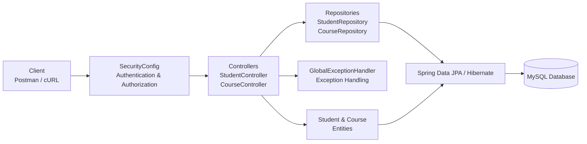

# Student Management System (SMS) with Spring Boot

A RESTful Student Management System built using **Java, Spring Boot, Spring Data JPA, and MySQL**. This project was developed incrementally through practical experiments, for the Enterprise Java course at IIIT Soneapt.

## Tech Stack

- **Language:** Java 21
- **Framework:** Spring Boot 4.2.0
- **Build Tool:** Maven
- **Database:** MySQL
- **ORM:** Hibernate / Spring Data JPA
- **Security:** Spring Security
- **Validation:** Jakarta Bean Validation
- **Testing:** JUnit 5, Spring Boot Test, MockMvc
- **API Testing:** Postman, cURL
- **Version Control:** Git and GitHub

## Application Architecture

The following diagram illustrates how the different components of the application interact:



## Setup and Initial Starting

### 1. Clone the Repository

```bash
git clone https://github.com/midaksh/student-management-system-SMS--spring-boot.git
cd student-management
```

### 2. Configure MySQL

Create the database:

```sql
CREATE DATABASE student_management;
```

Make sure your MySQL server is running.

### 3. Configure Environment Variables

The application uses an environment variable for the MySQL Database Password.

Create your local `.env` file using the example:

```bash
cp .env.example .env
```

Update `.env` with your MySQL root password:

```env
DB_PASSWORD=your_mysql_password
```

**Note:** `.env` is not automatically loaded by Spring Boot. If using the `run.sh` script configured to load `.env`, start the application using `./run.sh`.


### 4. Configure Application Properties

Update `src/main/resources/application.properties`:

```properties
spring.application.name=student-management

server.port=8081

spring.datasource.url=jdbc:mysql://localhost:3306/student_management
spring.datasource.username=root
spring.datasource.password=${DB_PASSWORD}
spring.datasource.driver-class-name=com.mysql.cj.jdbc.Driver

spring.jpa.hibernate.ddl-auto=update
spring.jpa.show-sql=true
spring.jpa.properties.hibernate.format_sql=true

spring.security.user.name=Admin
spring.security.user.password=admin123
```

### 5. Run the Application

Start the MySQL server, then execute:

```bash
./run.sh
```

The application will run at:

`http://localhost:8081`

## File Responsibilities

| File | Function |
|---|---|
| `StudentManagementApplication.java` | Main Spring Boot application entry point. |
| `Student.java` | Student entity and database mapping. |
| `Course.java` | Course entity and relationship with Student. |
| `StudentController.java` | Handles student REST API requests. |
| `CourseController.java` | Handles course REST API requests. |
| `StudentRepository.java` | Database operations and student queries. |
| `CourseRepository.java` | Database operations for courses. |
| `SecurityConfig.java` | Configures HTTP Basic authentication and endpoint access. |
| `GlobalExceptionHandler.java` | Centralized exception and validation error handling. |
| `StudentManagementApplicationTests.java` | Automated application and API tests. |
| `.env.example` | Example environment variable configuration. |

## Experiments Completed

### 1: Spring Boot Project Setup
- Created a Maven-based Spring Boot project and understood its structure.

### 2: First REST Endpoint
- Created a `/hello` endpoint using Spring REST annotations.

### 3: CRUD Operations Using ArrayList
- Implemented in-memory student CRUD operations using GET, POST, PUT, and DELETE.

### 4: MySQL Integration Using Spring Data JPA
- Connected MySQL and implemented persistent student CRUD operations using JPA.

### 5: Derived Queries, Pagination and Sorting
- Implemented student search, derived queries, pagination, and sorting.

### 6: Student–Course One-to-Many Relationship
- Established a Student–Course relationship and added unique database constraints.

### 7: Input Validation and Global Exception Handling
- Implemented Jakarta validation and centralized exception handling.

### 8: REST API Testing and Automated Testing
- Tested APIs using cURL and implemented automated JUnit and MockMvc tests.

### 9: Spring Security
- Implemented HTTP Basic Authentication, public and protected endpoints, and fixed login credentials.

## API Endpoints

Base URL: `http://localhost:8081`

**Authentication:** All endpoints except `GET /hello` require HTTP Basic Authentication.

### Student APIs

| Method | Endpoint | Description |
|---|---|---|
| GET | `/students` | Retrieve all students |
| POST | `/students` | Create a student |
| GET | `/students/{id}` | Retrieve a student by ID |
| PUT | `/students/{id}` | Update a student |
| DELETE | `/students/{id}` | Delete a student |
| GET | `/students/search/name?name=Midaksh` | Search by exact name |
| GET | `/students/search?keyword=ak` | Search by partial name |
| GET | `/students/search/email?email=midaksh@example.com` | Search by email |
| GET | `/students/paginated?page=0&size=5` | Retrieve paginated students |
| GET | `/students/sorted` | Retrieve sorted students |

### Course APIs

| Method | Endpoint | Description |
|---|---|---|
| GET | `/courses` | Retrieve all courses |
| GET | `/courses/{id}` | Retrieve a course by ID |
| POST | `/courses/student/{studentId}` | Add a course to a student |
| GET | `/courses/student/{studentId}` | Retrieve courses belonging to a student |
| DELETE | `/courses/{id}` | Delete a course |

### Hello API

| Method | Endpoint | Description |
|---|---|---|
| GET | `/hello` | Returns a welcome message |

## Example API Requests

### Create a Student

**POST** `/students`

```json
{
  "name": "John Doe",
  "email": "john@example.com"
}
```

Expected response: `201 Created`

### Update a Student

**PUT** `/students/1`

```json
{
  "name": "John Updated",
  "email": "john.updated@example.com"
}
```

Expected response: `200 OK`

### Add a Course to a Student

**POST** `/courses/student/1`

```json
{
  "courseName": "Data Structures and Algorithms",
  "courseCode": "CS201"
}
```

### Example Validation Error

Sending an invalid student payload:

```json
{
  "name": "",
  "email": "invalid-email"
}
```

Expected response: `400 Bad Request`

```json
{
  "name": "Student name is required",
  "email": "Please provide a valid email address"
}
```

## Spring Security

The application uses Spring Security with HTTP Basic Authentication.

| Configuration | Value |
|---|---|
| Authentication Type | HTTP Basic |
| Username | `Admin` |
| Password | `admin123` |
| Public Endpoint | `GET /hello` |
| Protected Endpoints | All other endpoints |

### Test Authentication

Public endpoint:

```bash
curl -i http://localhost:8081/hello
```

Expected: `200 OK`

Access a protected endpoint without credentials:

```bash
curl -i http://localhost:8081/students
```

Expected: `401 Unauthorized`

Access with valid credentials:

```bash
curl -i -u Admin:admin123 http://localhost:8081/students
```

Expected: `200 OK`

Access with incorrect credentials:

```bash
curl -i -u Admin:wrong123 http://localhost:8081/students
```

Expected: `401 Unauthorized`

## HTTP Status Codes

| Status Code | Meaning | Usage |
|---|---|---|
| 200 | OK | Successful GET or PUT |
| 201 | Created | Student successfully created |
| 204 | No Content | Successful deletion |
| 400 | Bad Request | Invalid request or validation failure |
| 401 | Unauthorized | Missing or invalid authentication |
| 404 | Not Found | Requested resource does not exist |
| 409 | Conflict | Duplicate student email or course code |

## Automated Testing

Run the test suite using:

```bash
./mvnw test
```

For a clean build and test execution:

```bash
./mvnw clean test
```

The current automated tests cover:

- Application context loading.
- Hello endpoint response.
- Invalid student data and validation errors.

## Database Design

The application currently uses two main entities:

**Student**
- `id` – Primary key, auto-generated.
- `name` – Student name.
- `email` – Unique student email.
- `courses` – Collection of associated courses.

**Course**
- `id` – Primary key, auto-generated.
- `courseName` – Course name.
- `courseCode` – Course code.
- `student_id` – Foreign key referencing the student.

Relationship:

```text
Student (1) ─────────── (N) Course
```

Each student can have multiple courses, while each course belongs to one student.

## Current Project Status

- [x] Experiments 1–9 completed
- [x] REST API CRUD operations
- [x] MySQL database integration
- [x] Spring Data JPA
- [x] Derived queries, pagination and sorting
- [x] Student–Course relationship
- [x] Input validation
- [x] Global exception handling
- [x] cURL API testing
- [x] JUnit and MockMvc automated testing
- [x] Spring Security Basic Authentication

---

**Author:** Midaksh Pandita  
**GitHub:** [@midaksh](https://github.com/midaksh)